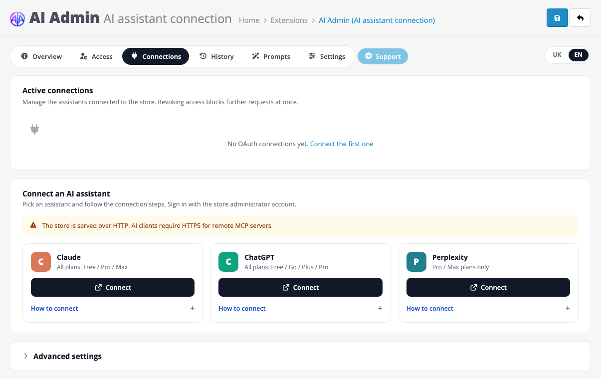

<div align="center">


# AI Admin for OpenCart

**Talk to your store. Connect OpenCart to Claude, ChatGPT or Perplexity and ask it anything about your shop.**

[](https://aia.in.ua/en/#pricing)
[](https://aia.in.ua/en/)
[](https://t.me/ocaiadmin)


[English](#english) · [Українська](#українська)



</div>

---

## English

AI Admin is an OpenCart extension that turns your store into an **MCP server**. Install it like any other module,
press **Connect** next to your assistant, sign in with your admin account, and the AI can work with your real store data.

> **This repository is the FREE edition.** The assistant **reads** your store and never changes anything.
> Editing prices, stock, content, orders and images is in the full version —
> **[get AI Admin for $49, one-time, no subscription →](https://aia.in.ua/en/#pricing)**

### What you can ask

```text
Which products are out of stock or about to run out?
Which categories have products without descriptions, photos or meta titles?
Find products priced above 5,000 that have no special price.
List the manufacturers and how many active products each has.
Check the SEO URLs: which products and categories have none?
```

### FREE vs full version

|                                                    | **FREE** (this repo) | **AI Admin** — [$49 one-time](https://aia.in.ua/en/#pricing) |
| -------------------------------------------------- | :------------------: | :----------------------------------------------------------: |
| Connect Claude, ChatGPT, Perplexity, any MCP client |          ✅          |                              ✅                              |
| Unlimited AI connections                           |          ✅          |                              ✅                              |
| Read catalog, CMS pages, marketing, localisation   |          ✅          |                              ✅                              |
| Low stock, store info, read-only SQL on open tables |          ✅          |                              ✅                              |
| Read orders, customers, sales reports              |          —           |                              ✅                              |
| Activity history with a tamper-evident log         |          ✅          |                              ✅                              |
| Edit prices and stock, bulk updates from price lists |          —           |                              ✅                              |
| Create and edit products, categories, brands, blog |          —           |                              ✅                              |
| Process orders and statuses                        |          —           |                              ✅                              |
| Import images by link or upload                    |          —           |                              ✅                              |
| Undo any AI change by its number                   |          —           |                              ✅                              |
| Full access control per section, manual settings   |   Safe profile only  |                              ✅                              |
| Ready-made and custom prompts                      |          —           |                              ✅                              |
| 1 month of support                                 |          —           |                              ✅                              |

**[→ Buy the full version at aia.in.ua](https://aia.in.ua/en/#pricing)** · one license per domain · no monthly fees

### Install

1. Download the archive for your store from [**Releases**](../../releases) (or build it yourself, see below):

   | Store                         | Archive                     |
   | ----------------------------- | --------------------------- |
   | OpenCart 3.0.x / ocStore 3.0.x | `ai_admin_oc3.ocmod.zip`  |
   | OpenCart 4.0.1+ / 4.1.x       | `ai_admin_oc4.ocmod.zip`  |

2. **Admin → Extensions → Installer** → upload the archive.
3. **Extensions → Extensions → Modules → AI Admin** → **Install**, then **Edit**.
4. Enter the activation code **`ai-admin-free`** (works offline, on any domain) and switch the module on.
5. Open the **Connections** tab, press **Connect** next to your assistant and sign in with the store admin account.

> AI services connect only to stores served over **HTTPS**.

### Security

- **Read-only by design:** the FREE build ships no tools that write and is locked on the **Safe** access profile:
  orders, customers, reviews, coupons and system settings stay closed to the AI.
- **Your admin password never leaves the store:** sign-in is OAuth 2.1 with PKCE; you can revoke any connection in one click.
- **Secrets stay hidden:** admin users, API keys, sessions, passwords and payment settings are never readable;
  e-mails and phone numbers are masked in the log.
- **Every call is logged** with a hash chain, so the history cannot be quietly edited.
- No telemetry and no calls to the vendor: the module talks only to your store and to the assistant you connect.

### Compatibility

Each version is checked on fresh stores from the official archives: install through the admin Installer,
44 protocol checks and 17 OAuth sign-in checks.

| Store       | Tested versions                                                | PHP     | Database                         |
| ----------- | -------------------------------------------------------------- | ------- | -------------------------------- |
| OpenCart 3  | 3.0.2.0, 3.0.3.2, 3.0.3.8, 3.0.3.9, 3.0.4.0, 3.0.5.0, 3.0.5.1  | 7.1–8.3 | MySQL 5.7 / 8.0, MariaDB 10.3–11 |
| ocStore 3   | 3.0.2.0, 3.0.3.7, 3.0.4.1                                      | 7.3–8.1 | MariaDB 10.3 / 10.6, MySQL 8.0   |
| OpenCart 4  | 4.0.1.1, 4.0.2.3, 4.1.0.0, 4.1.0.3, 4.1.0.4                    | 8.1–8.4 | MySQL 8.0, MariaDB 10.6–11       |

Requirements: PHP 7.1+ with `mysqli` and `openssl` — present on any host that runs OpenCart.
No Composer, no Node, no separate server.

### Build from source

```sh
build/build.sh   # writes the OCMOD archives to dist/
build/test.sh    # PHP lint + tests on PHP 7.1 / 7.4 / 8.3 (Docker)
```

| Path              | What is there                                              |
| ----------------- | ---------------------------------------------------------- |
| `src/mcp/`        | the MCP server core shared by OpenCart 3 and 4             |
| `packages/oc3/`   | OpenCart 3 / ocStore controllers, languages, OCMOD         |
| `packages/oc4/`   | OpenCart 4 extension                                       |
| `packages/shared/`| the admin page source — edit here, then `python3 build/gen_admin.py` |

### Support

Questions and bug reports: **[Telegram @ocaiadmin](https://t.me/ocaiadmin)** or [GitHub Issues](../../issues).

---

## Українська

**AI Admin** — розширення для OpenCart, яке перетворює магазин на **MCP-сервер**. Встановіть його як звичайний модуль,
натисніть **Підключити** біля свого асистента (Claude, ChatGPT, Perplexity), увійдіть з акаунтом адміністратора — і ШІ
працює з реальними даними вашого магазину.

> **Тут — безкоштовна FREE-версія.** Асистент лише **читає** дані магазину й нічого не змінює.
> Редагування цін, залишків, контенту, замовлень і фото — у повній версії:
> **[купити AI Admin за $49 — один раз, без підписки →](https://aia.in.ua/#pricing)**

**Що можна запитати:** «яких товарів немає в наявності?», «в яких категоріях товари без опису чи фото?»,
«у яких товарів і категорій немає SEO-адреси?». У FREE-версії ШІ бачить каталог, сторінки, маркетинг і
локалізацію; замовлення та клієнти закриті.

### Встановлення

1. Завантажте архів із [**Releases**](../../releases): `ai_admin_oc3.ocmod.zip` для OpenCart 3 / ocStore,
   `ai_admin_oc4.ocmod.zip` для OpenCart 4.
2. **Розширення → Встановлювач** → завантажте архів.
3. **Розширення → Розширення → Модулі → AI Admin** → **Встановити**, потім **Редагувати**.
4. Введіть код активації **`ai-admin-free`** і увімкніть модуль.
5. На вкладці **Підключення** натисніть **Підключити** біля свого асистента.

### Повна версія

Повна версія **AI Admin** — **$49 один раз** за домен, без щомісячних платежів: зміна цін і залишків (зокрема з
прайсів постачальників), створення товарів, категорій і статей, обробка замовлень, фото, відкат будь-якої зміни ШІ,
готові промпти й місяць підтримки.

<div align="center">

**[→ Купити на aia.in.ua](https://aia.in.ua/#pricing)** · **[Telegram @ocaiadmin](https://t.me/ocaiadmin)**

</div>
